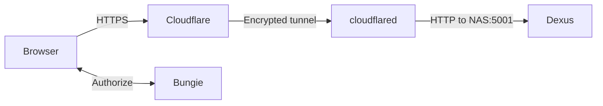

# Bungie OAuth deployment with Cloudflare Tunnel

This guide deploys Dexus on a Linux NAS when `cloudflared` runs in a Docker bridge container. Cloudflare provides public HTTPS; the connection from cloudflared to Dexus remains private HTTP.



## 1. Configure Bungie

Create or edit a confidential application in the [Bungie application portal](https://www.bungie.net/en/Application).

For `dexus.example.com`, configure:

| Setting | Value |
|---|---|
| OAuth client type | Confidential |
| Redirect URL | `https://dexus.example.com/callback` |
| Permissions | Read inventory/vault and move/equip items |

Keep the API key, client ID, and client secret private.

## 2. Find the NAS and Docker addresses

Find the NAS LAN address:

```bash
ip -4 -brief address
```

Find the Docker bridge subnet and gateway:

```bash
sudo docker network inspect bridge \
  --format 'subnet={{(index .IPAM.Config 0).Subnet}} gateway={{(index .IPAM.Config 0).Gateway}}'
```

The examples below use NAS address `192.168.1.25`, subnet `172.17.0.0/16`, and gateway `172.17.0.1`. Substitute the values from your NAS.

## 3. Configure Dexus

```bash
cp .env.example .env
chmod 600 .env
```

Set:

```dotenv
BungieAPIKeys__API_Key=YOUR_BUNGIE_API_KEY
BungieAPIKeys__Client_ID=YOUR_BUNGIE_CLIENT_ID
BungieAPIKeys__Client_Secret=YOUR_BUNGIE_CLIENT_SECRET
AllowedHosts=dexus.example.com
Dexus__KnownProxies__0=::ffff:172.17.0.1
```

The trusted proxy must match `HttpContext.Connection.RemoteIpAddress` exactly. Kestrel often reports Docker's IPv4 gateway in mapped IPv6 form. Do not use a hostname, URL, port, NAS address, or cloudflared address unless the diagnostic log shows that exact peer.

## 4. Build and launch

```bash
sudo docker build -t dexus:latest .
sudo env BIND_ADDRESS=192.168.1.25 ./build.sh --run-only
```

Passing `BIND_ADDRESS` after `sudo` matters because sudo normally removes custom environment variables.

Verify:

```bash
sudo docker ps --filter name=dexus
sudo docker port dexus
sudo docker logs --tail 100 dexus
```

The port output should resemble:

```text
8080/tcp -> 192.168.1.25:5001
```

## 5. Configure Cloudflare Tunnel

Add a published application route:

| Setting | Value |
|---|---|
| Public hostname | `dexus.example.com` |
| Service type | HTTP |
| Service URL | `192.168.1.25:5001` |

Use HTTP for the private origin. The browser still uses HTTPS through Cloudflare. Dexus does not serve HTTPS on port 5001.

Do not use `127.0.0.1:5001` from a bridge-mode cloudflared container; container loopback refers to cloudflared itself.

## 6. Configure the firewall

Allow the Docker bridge subnet first, then deny other sources:

```text
ALLOW 172.17.0.0/16 -> TCP 5001
DENY  all other sources -> TCP 5001
```

Do not create a router port-forward for 5001. Cloudflare Tunnel establishes outbound connections and does not require one.

## 7. Verify forwarded HTTPS

If Dexus reports that an HTTP request cannot use secure antiforgery cookies, temporarily add:

```dotenv
Logging__LogLevel__Microsoft.AspNetCore.HttpOverrides=Debug
```

Recreate Dexus, request the public page, and inspect:

```bash
sudo docker logs --since 2m dexus
```

A message such as this reveals the exact peer:

```text
Unknown proxy: [::ffff:172.17.0.1]:46154
```

Configure the address without brackets or port, remove the temporary debug setting, and recreate the container again.

## 8. Test OAuth

Start and finish on the public hostname:

1. Open `https://dexus.example.com`.
2. Select Bungie sign-in.
3. Authorize the application at Bungie.
4. Confirm the callback returns to the account page.
5. Load characters and vault contents, refresh, sign out, and perform one agreed test transfer.

Direct `http://NAS_ADDRESS:5001` browsing is not a valid OAuth test. Dexus requires the original public request to be HTTPS.

## Troubleshooting

| Symptom | Likely cause |
|---|---|
| Cloudflare 502 | Firewall blocked the Docker subnet, wrong NAS address, stopped container, or HTTPS selected for the HTTP origin |
| HTTP 400 invalid hostname | Public hostname is absent from `AllowedHosts` |
| Antiforgery HTTPS error | `KnownProxies` does not exactly match the observed peer |
| Connection refused on NAS IP | Dexus is bound to loopback; recreate with `sudo env BIND_ADDRESS=...` |
| Bungie callback error | Registered callback does not exactly match `https://PUBLIC_HOST/callback` |
| Credentials unavailable | `.env` was not loaded or contains placeholders; recreate instead of restarting |

Changes to `.env` are applied only when the container is recreated with `./build.sh --run-only`.
