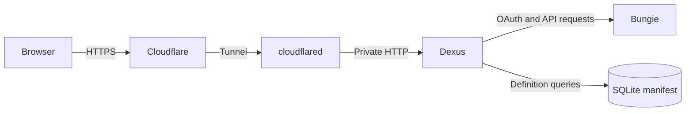

# Dexus

Dexus is a self-hosted Destiny 2 inventory manager built with .NET and Blazor. It signs visitors in through Bungie, loads their characters and inventory, and provides a visual vault interface for moving and equipping items.

The public demo is available at [dexus.maxbroome.dev](https://dexus.maxbroome.dev).

## Features

- Bungie OAuth sign-in with application credentials and user tokens kept on the server.
- Destiny 2 profile, character, equipment, inventory, and vault loading.
- Local Destiny manifest caching and SQLite-backed item definition lookup.
- Item grouping by character, equipped state, inventory, and vault location.
- Drag-and-drop transfer and equip operations through Bungie's API.

## Architecture



Cloudflare terminates public HTTPS and forwards the original scheme and client address. Dexus accepts those forwarded headers only from the configured proxy. Bungie OAuth begins and completes on server endpoints. The browser receives a protected cookie containing a random session identifier; API tokens remain in an isolated, in-memory server session.

Sessions last up to eight hours. Restarting Dexus signs everyone out, and the current session store supports one application instance.

## Technology

- .NET 9 and ASP.NET Core
- Blazor interactive server and WebAssembly components
- MudBlazor
- Bungie.net OAuth and Destiny 2 Platform APIs
- SQLite via `Microsoft.Data.Sqlite`
- Docker and Cloudflare Tunnel

## Local development

Requirements:

- .NET 9 SDK
- Optional Bungie application credentials for live sign-in

Build and run:

```bash
dotnet build Dexus/Dexus/Dexus.csproj -c Release
env -u Dexus__KnownProxies__0 dotnet run --project Dexus/Dexus
```

`dotnet run` uses ASP.NET configuration and does not automatically import the repository `.env` file. That file is intended for the Docker launcher.

Run the security regression suite:

```bash
env -u AllowedHosts -u Dexus__KnownProxies__0 \
  dotnet run --project tests/Dexus.SecurityChecks -c Release
```

The suite exercises OAuth state expiry and replay protection, browser binding, separate visitor sessions, reloads, cookie flags, logout antiforgery, session revocation, and the actual account page using a fake Bungie provider.

## Configuration

Copy the example and protect it:

```bash
cp .env.example .env
chmod 600 .env
```

Configure server-side values:

```dotenv
BungieAPIKeys__API_Key=YOUR_BUNGIE_API_KEY
BungieAPIKeys__Client_ID=YOUR_CONFIDENTIAL_CLIENT_ID
BungieAPIKeys__Client_Secret=YOUR_CLIENT_SECRET
AllowedHosts=dexus.example.com
Dexus__KnownProxies__0=YOUR_PROXY_ADDRESS_AS_SEEN_BY_DEXUS
```

Register this exact callback in the Bungie application portal:

```text
https://dexus.example.com/callback
```

Never commit `.env`, put these values in client `wwwroot` settings, or place tokens in browser storage. Configuration can alternatively be mounted as files under `/run/secrets` using the same double-underscore names.

`Dexus__KnownProxies__0` is the immediate source address Dexus observes, not the public hostname or a URL. With Docker dual-stack networking, an IPv4 gateway may appear as an IPv4-mapped IPv6 address such as `::ffff:172.17.0.1`.

## Docker

Build the solution and Docker image:

```bash
./build.sh
```

Build and start Dexus, or start an existing image:

```bash
./build.sh --run
./build.sh --run-only
```

The launcher reads `.env`, creates persistent volumes for the manifest and ASP.NET Data Protection keys, and recreates the named container when necessary. The container runs as a non-root user with a read-only root filesystem, dropped Linux capabilities, `no-new-privileges`, and process and temporary-storage limits.

Dexus binds to `127.0.0.1:5001` by default. A bridge-mode cloudflared container cannot reach the NAS loopback address, so bind Dexus to the NAS LAN address for that topology:

```bash
sudo env BIND_ADDRESS=192.168.1.25 ./build.sh --run-only
```

Replace the example with the actual NAS address. Configure Cloudflare's origin as `http://NAS_ADDRESS:5001`, allow TCP 5001 from the Docker subnet in the NAS firewall, deny other sources, and do not forward that port on the router.

Useful NAS checks:

```bash
sudo docker ps --filter name=dexus
sudo docker port dexus
sudo docker logs --tail 100 dexus
```

See [BUNGIE_OAUTH_SETUP.md](BUNGIE_OAUTH_SETUP.md) for the complete deployment and troubleshooting guide.

## Security model

- Application credentials stay in server configuration or mounted secrets.
- OAuth tokens stay in bounded, user-isolated server memory.
- OAuth state is random, hashed, browser-bound, expires after ten minutes, and is consumed before code exchange.
- Session and antiforgery cookies are `Secure` and `HttpOnly`.
- Forwarded headers are accepted only from configured proxies.
- Sensitive account and authentication responses use `Cache-Control: no-store`.
- Global request limiting and conservative Kestrel request limits are enabled.
- Generated manifests, profiles, build output, credentials, and environment files are excluded from Git and Docker builds.

See [SECURITY.md](SECURITY.md) for the supported deployment and reporting policy.

## Limitations

- One Dexus process is supported; there is no distributed session store.
- A restart invalidates every login.
- Full local ownership validation and transfer-concurrency coverage remain future work; Bungie also authorizes operations against the signed-in user's token.
- Manifest downloads are serialized, but atomic replacement and corruption recovery remain future work.
- Some supporting projects retain analyzer and nullability warnings.

The current verification record is in [DEMO_READINESS.md](DEMO_READINESS.md).

## Release checklist

1. Run the Release build and security regression suite.
2. Run `dotnet list Dexus.sln package --vulnerable --include-transitive`.
3. Build a fresh image from the intended commit.
4. Confirm environment files, build output, manifests, and profile data are absent from the image and Git history.
5. Confirm the Bungie callback exactly matches the public HTTPS hostname.
6. Verify the trusted proxy address, firewall, WebSockets, and HTTPS scheme forwarding.
7. Rehearse sign-in, inventory loading, refresh, logout, and a consented transfer with real accounts.

## License

See [LICENSE](LICENSE). The repository is publicly viewable, but the current license does not grant general open-source reuse rights.
